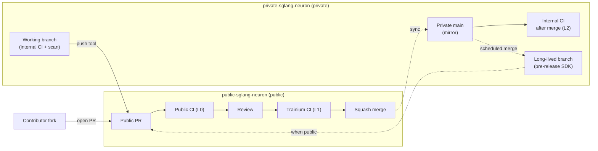

# Demo: private development repository and sync

This demo runs the development flow of the SGLang-Neuron open source operating model (proposal) on two
repositories:

| Repository | Stands in for | Visibility |
|---|---|---|
| [`zwang-amazon/public-sglang-neuron`](https://github.com/zwang-amazon/public-sglang-neuron) | `sgl-project/sglang-neuron` | Public |
| [`zwang-amazon/private-sglang-neuron`](https://github.com/zwang-amazon/private-sglang-neuron) | Neuron private development repository | Private |

The code is a synthetic package. Codenames, ticket ids and host names in the scan examples are made up.

## Flow



## Mechanisms

| Mechanism | Operating model | Implementation |
|---|---|---|
| Public `main` is the only place code lands | §2; §3 merge rules | Ruleset on `main`: pull request, required checks `L0` and `L1 Trainium gate`, squash only, no force push or deletion, no bypass |
| Private `main` is a mirror | §2 | Private repo `sync-public-main.yml`: fetches public `main` (no credential) and fast-forwards private `main` as the sync GitHub App; identical SHAs. A guard step alerts on any non-bot change to private `main` |
| Push tool | §2 | Private repo `tools/push_public.py`: scan, public head check against the last pushed SHA, push without force, open the PR on the first push, stop on commits pushed by others |
| Internal-information scan | §2 | Private repo `tools/internal_scan.py` with a denylist of made-up codenames and patterns; runs in the push tool and in internal CI |
| Public CI L0 and L1 | §4; Appendix A.2, A.3 | `l0.yml`, `l1-trainium.yml`, `l1-gate.yml` in this repository |
| Fork safety | Appendix A.3 | Pull request code runs only under `pull_request` (read-only token, no secrets). Privileged workflows run default-branch code only; `tools/ci/check_workflows.py` in L0 enforces it. Unapproved pull requests that change `.github/` fail the gate |
| Internal CI | §4; Appendix A.2, A.4 | Private repo `internal-ci.yml` on working branches before push; L2 post-merge batch on private `main` after each sync |
| External contributors | §4; Appendix B.6 | Fork pull requests run L0 here; L1 waits for maintainer approval; nothing is imported into the private repository |
| Long-lived private branch | §2 | Private repo `merge-main-into-longlived.yml` merges private `main` on a schedule; the branch is published with the push tool |

## Scenarios

Each scenario was run once, on 2026-11-25. Links into `private-sglang-neuron` work only for its owner;
in the real setup, public pull requests carry no internal links.

| # | Scenario | What happened | Links |
|---|---|---|---|
| 0 | First Neuron change (CI fix, no hardware path) | Push tool: scan clean, internal CI green, branch pushed, PR opened. `L1 Trainium gate` passed without Trainium tests because no hardware path changed. Squash-merged | [PR #1](https://github.com/zwang-amazon/public-sglang-neuron/pull/1) |
| 1 | Neuron change, end to end | Private working branch `dev/rmsnorm-fsum` changes `sglang_neuron/kernels/`. Internal CI green on the exact commit, push tool opened the PR, L0 and L1 passed, squash merge. The sync bot created private `main` at the same SHA as public `main`, then L2 ran on it | [internal CI](https://github.com/zwang-amazon/private-sglang-neuron/actions/runs/45545712416), [PR #2](https://github.com/zwang-amazon/public-sglang-neuron/pull/2), [L1](https://github.com/zwang-amazon/public-sglang-neuron/actions/runs/45545764956), [sync and L2](https://github.com/zwang-amazon/private-sglang-neuron/actions/runs/45546854650) |
| 2 | Review feedback | A review asked to reject an empty row. The fix was committed on the private branch and pushed by the tool as a new commit; nothing was force-pushed | [review](https://github.com/zwang-amazon/public-sglang-neuron/pull/2#pullrequestreview-6051797648), [internal CI](https://github.com/zwang-amazon/private-sglang-neuron/actions/runs/45545927688), [commit](https://github.com/zwang-amazon/public-sglang-neuron/pull/2/commits/17a6c309dae1) |
| 3 | Suggested change on the public branch | A reviewer committed a suggestion on the public PR branch. The developer's next run of the push tool stopped, listed that commit and printed the fetch commands. After `git fetch` and `git rebase`, the tool pushed again | [suggestion](https://github.com/zwang-amazon/public-sglang-neuron/pull/2#discussion_r4690339702), [suggestion commit](https://github.com/zwang-amazon/public-sglang-neuron/commit/872b8c668963b380cbe695cb461dacce959151cd), [L1 on the new head](https://github.com/zwang-amazon/public-sglang-neuron/actions/runs/45546090433) |
| 4 | Scan blocks a codename | A commit whose message and code comment held a denylisted codename, a fake ticket id and a fake internal host name: the push tool reported 4 findings and pushed nothing, and internal CI failed at the scan step. After the unpushed commit was amended, the tool pushed it | [internal CI scan failure](https://github.com/zwang-amazon/private-sglang-neuron/actions/runs/45547039077), [PR #3](https://github.com/zwang-amazon/public-sglang-neuron/pull/3), [sync and L2](https://github.com/zwang-amazon/private-sglang-neuron/actions/runs/45547302612) |
| 5 | External fork PR | Not run: the demo has one GitHub account. The mechanism is in place (see below) | |
| 6 | Long-lived branch | `prerelease/sdk-next` holds a kernel that waits for an SDK release. The scheduled merge bot merged private `main` into it and started internal CI; the push tool then published it as a new public branch | [merge bot](https://github.com/zwang-amazon/private-sglang-neuron/actions/runs/45547387426), [internal CI](https://github.com/zwang-amazon/private-sglang-neuron/actions/runs/45547413432), [PR #4](https://github.com/zwang-amazon/public-sglang-neuron/pull/4), [sync and L2](https://github.com/zwang-amazon/private-sglang-neuron/actions/runs/45547635742) |

Push tool output in scenario 3:

```text
push-tool: STOP: someone else pushed 1 commit(s) to public branch 'dev/rmsnorm-fsum':
    872b8c6 zwang-amazon: Apply suggestion from code review
Fetch them into this private branch first, then run the tool again:
    git fetch public dev/rmsnorm-fsum
    git rebase public/dev/rmsnorm-fsum      # or: git merge public/dev/rmsnorm-fsum
```

### External contributors (scenario 5, not run)

- A fork pull request runs L0 and the `L1 Trainium CI` workflow under `pull_request`: read-only token, no secrets.
- If it changes `sglang_neuron/kernels/` and the author is not in `.github/CI_PERMISSIONS.json`, the Trainium tests are
  skipped and `L1 Trainium gate` stays pending.
- A maintainer reviews the commits and comments `/tag-and-rerun-ci` (or adds `run-ci`). The gate records
  `ci/run-ci-approved` on that head commit and re-runs L1. A new push needs a new approval.
- A fork pull request that changes `.github/` fails the gate until a maintainer approves it.
- Nothing from a fork is imported into the private repository. It reaches private `main` only after it is merged,
  through the sync.

## Bot identities

| Bot | Identity | Credential |
|---|---|---|
| Public CI and L1 gate | `github-actions[bot]` | This repository's `GITHUB_TOKEN` |
| Sync and long-lived merge | `sglang-neuron-sync-demo[bot]`, a GitHub App installed on the private repository only (Contents and Workflows write) | One-hour installation token per run. `GITHUB_TOKEN` cannot push the mirrored `.github/workflows/` files |
| Internal CI and L2 | `github-actions[bot]` in the private repository | The private repository's `GITHUB_TOKEN` |
| Push tool | The developer's own GitHub account | The developer's login |

## Stubs and limits

- Trainium and internal machines are stubs: `ubuntu-latest` with a stub device.
- Required approvals are 0 because the demo has one maintainer account. Code owner review is off for the same reason.
- Rulesets and branch protection are not available for private repositories on this account's plan. The sync bot's
  guard enforces "private `main` only from the bot" by reading the activity log, alerting with an issue and stopping
  the sync; it cannot reject a push.
- The sync runs every 3 hours and on demand; the demo ran it by hand after each merge.
- Fork workflow approval is set to "first-time contributors who are new to GitHub", so L0 runs automatically for
  other contributors.
- `L1 Trainium gate` is a commit status from `github-actions[bot]`. In the real setup, L1 comes from Neuron's CI
  platform under its own app identity, which the ruleset can pin.
