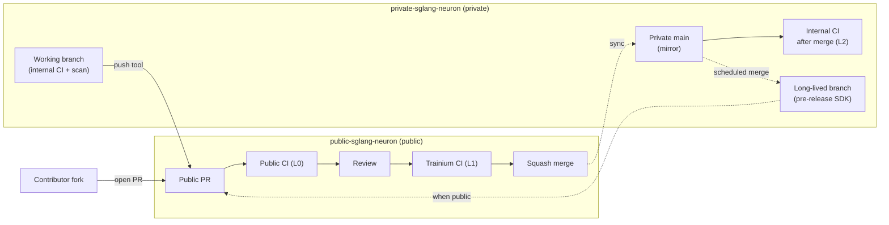

# Demo: private development repository and sync

This demo runs the development flow of the SGLang-Neuron open source operating model (proposal) on two
repositories:

| Repository | Stands in for | Visibility |
|---|---|---|
| [`zwang-amazon/public-sglang-neuron`](https://github.com/zwang-amazon/public-sglang-neuron) | `sgl-project/sglang-neuron` | Public |
| [`zwang-amazon/private-sglang-neuron`](https://github.com/zwang-amazon/private-sglang-neuron) | Neuron private development repository | Private |

The code is a synthetic package. Codenames, ticket ids and host names in the scan examples are made up.

## Flow

## Mechanisms

| Mechanism | Operating model | Implementation |
|---|---|---|
| Public `main` is the only place code lands | §2; §3 merge rules | Ruleset on `main`: pull request, required checks `L0` and `L1 Trainium gate`, squash only, no force push or deletion, no bypass |
| Private `main` is a mirror | §2 | Private repo `sync-public-main.yml`: fetches public `main` (no credential) and fast-forwards private `main` with the private repo's own `GITHUB_TOKEN`; identical SHAs. A guard step alerts on any non-bot change to private `main` |
| Push tool | §2 | Private repo `tools/push_public.py`: scan, public head check against the last pushed SHA, push without force, open the PR on the first push, stop on commits pushed by others |
| Internal-information scan | §2 | Private repo `tools/internal_scan.py` with a denylist of made-up codenames and patterns; runs in the push tool and in internal CI |
| Public CI L0 and L1 | §4; Appendix A.2, A.3 | `l0.yml`, `l1-trainium.yml`, `l1-gate.yml` in this repository |
| Fork safety | Appendix A.3 | Pull request code runs only under `pull_request` (read-only token, no secrets). Privileged workflows run default-branch code only; `tools/ci/check_workflows.py` in L0 enforces it. Unapproved pull requests that change `.github/` fail the gate |
| Internal CI | §4; Appendix A.2, A.4 | Private repo `internal-ci.yml` on working branches before push; L2 post-merge batch on private `main` after each sync |
| External contributors | §4; Appendix B.6 | Fork pull requests run L0 here; L1 waits for maintainer approval; nothing is imported into the private repository |
| Long-lived private branch | §2 | Private repo `merge-main-into-longlived.yml` merges private `main` on a schedule; the branch is published with the push tool |

## Scenarios

Run results with links are added here after the first end-to-end run.
