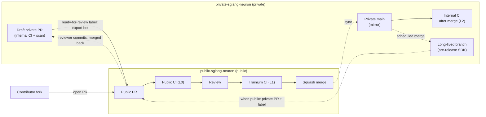

# Demo: private development repository and sync

This demo runs the development flow of the SGLang-Neuron open source operating model (proposal) on two
repositories:

| Repository | Stands in for | Visibility |
|---|---|---|
| [`zwang-amazon/public-sglang-neuron`](https://github.com/zwang-amazon/public-sglang-neuron) | `sgl-project/sglang-neuron` | Public |
| [`zwang-amazon/private-sglang-neuron`](https://github.com/zwang-amazon/private-sglang-neuron) | Neuron private development repository | Private |

The code is a synthetic package. Codenames, ticket ids and host names in the scan examples are made up.

## Flow

## Mechanisms

| Mechanism | Operating model | Implementation |
|---|---|---|
| Public `main` is the only place code lands | §2; §3 merge rules | Ruleset on `main`: pull request, required checks `L0` and `L1 Trainium gate`, squash only, no force push or deletion, no bypass |
| Private `main` is a mirror | §2 | Private repo `sync-public-main.yml`: fetches public `main` (no credential) and fast-forwards private `main` as the sync GitHub App; identical SHAs. A guard step alerts on any non-bot change to private `main` |
| Export bot (push tool) | §2 | Private repo `private-pr.yml` + `tools/export_pr.py`, on every private pull request event: keeps private pull requests as drafts (never merged privately); once labeled `ready-for-review`, scans, checks the public head against the last published SHA, requires internal CI on the exact commit, pushes without force and opens the public PR. Later pushes are published to the same PR; commits pushed to the public branch by others are merged back; the private PR is closed after the public merge |
| Internal-information scan | §2 | Private repo `tools/internal_scan.py` with a denylist of made-up codenames and patterns; runs in the export bot and in internal CI |
| Public CI L0 and L1 | §4; Appendix A.2, A.3 | `l0.yml`, `l1-trainium.yml`, `l1-gate.yml` in this repository |
| Fork safety | Appendix A.3 | Pull request code runs only under `pull_request` (read-only token, no secrets). Privileged workflows run default-branch code only; `tools/ci/check_workflows.py` in L0 enforces it. Unapproved pull requests that change `.github/` fail the gate |
| Internal CI | §4; Appendix A.2, A.4 | Private repo `internal-ci.yml` on working branches before push; L2 post-merge batch on private `main` after each sync |
| External contributors | §4; Appendix B.6 | Fork pull requests run L0 here; L1 waits for maintainer approval; nothing is imported into the private repository |
| Long-lived private branch | §2 | Private repo `merge-main-into-longlived.yml` merges private `main` into every `prerelease/*` branch on a schedule; the branch is published through a private PR |

## Scenarios

Each scenario was run once with the export bot on 2026-11-25. The developer only pushed branches, opened
private pull requests and added a label; everything else was automatic. Links into `private-sglang-neuron`
work only for its owner; public pull requests carry no internal links. (Public PRs #1 to #5 came from an
earlier version, in which developers ran the push steps as a command-line tool.)

| # | Scenario | What happened | Links |
|---|---|---|---|
| 0 | First export: a `.github/` change | Private PR #1 labeled; the bot published it. The gate failed because the PR changed `.github/` and its author, the bot, was not listed yet; a maintainer's `/tag-and-rerun-ci` approved it. Merged; the sync closed the private PR | [private #1](https://github.com/zwang-amazon/private-sglang-neuron/pull/1), [PR #6](https://github.com/zwang-amazon/public-sglang-neuron/pull/6) |
| 1 | Neuron change, end to end | Draft private PR #2 changes `sglang_neuron/kernels/`; internal CI ran on open. The label published it; L0 and L1 passed (L1 automatic: the bot is in `CI_PERMISSIONS.json`); squash merge; the sync fast-forwarded private `main`, ran L2, and the bot closed the private PR | [private #2](https://github.com/zwang-amazon/private-sglang-neuron/pull/2), [export run](https://github.com/zwang-amazon/private-sglang-neuron/actions/runs/45564091591), [PR #7](https://github.com/zwang-amazon/public-sglang-neuron/pull/7), [L1](https://github.com/zwang-amazon/public-sglang-neuron/actions/runs/45564174018), [sync, L2, close](https://github.com/zwang-amazon/private-sglang-neuron/actions/runs/45564825426) |
| 2 | Review feedback | A review asked to reject a non-finite `eps`. The developer pushed a new commit to the private branch; the bot published it to the same public PR | [review](https://github.com/zwang-amazon/public-sglang-neuron/pull/7#pullrequestreview-6053134731), [bot run](https://github.com/zwang-amazon/private-sglang-neuron/actions/runs/45564338371) |
| 3 | Suggested change on the public branch | A reviewer committed a suggestion on the public branch while the developer pushed another commit privately. The bot merged the reviewer's commit back into the private branch, and the next run published both, without force | [suggestion](https://github.com/zwang-amazon/public-sglang-neuron/pull/7#discussion_r4691438843), [merge-back run](https://github.com/zwang-amazon/private-sglang-neuron/actions/runs/45564490580), [publish run](https://github.com/zwang-amazon/private-sglang-neuron/actions/runs/45564559989), [PR #7 commits](https://github.com/zwang-amazon/public-sglang-neuron/pull/7/commits) |
| 4 | Scan blocks a codename | Private PR #4 was opened as ready (not draft) with the label already on it. The bot turned it back into a draft, and the scan found a made-up codename and a fake ticket id in a code comment: nothing was published, and the bot listed the findings on the private PR. After the developer amended the unpublished commit, the bot published it | [private #4](https://github.com/zwang-amazon/private-sglang-neuron/pull/4), [blocked run](https://github.com/zwang-amazon/private-sglang-neuron/actions/runs/45565120530), [PR #8](https://github.com/zwang-amazon/public-sglang-neuron/pull/8) |
| 5 | External fork PR | Not run: the demo has one GitHub account. The mechanism is in place (see below) | |
| 6 | Long-lived branch | `prerelease/sdk-preview` holds a kernel that waits for an SDK release. The scheduled merge bot merged private `main` into it and ran internal CI; a private PR with the label then published it | [merge bot](https://github.com/zwang-amazon/private-sglang-neuron/actions/runs/45565696805), [internal CI](https://github.com/zwang-amazon/private-sglang-neuron/actions/runs/45565717973), [private #5](https://github.com/zwang-amazon/private-sglang-neuron/pull/5), [PR #9](https://github.com/zwang-amazon/public-sglang-neuron/pull/9) |

GitHub refuses to merge a draft pull request, through the UI and the API (`405 Pull Request is still a
draft`), checked on a throwaway private PR: [private #3](https://github.com/zwang-amazon/private-sglang-neuron/pull/3).

### External contributors (scenario 5, not run)

- A fork pull request runs L0 and the `L1 Trainium CI` workflow under `pull_request`: read-only token, no secrets.
- If it changes `sglang_neuron/kernels/` and the author is not in `.github/CI_PERMISSIONS.json`, the Trainium tests are
  skipped and `L1 Trainium gate` stays pending.
- A maintainer reviews the commits and comments `/tag-and-rerun-ci` (or adds `run-ci`). The gate records
  `ci/run-ci-approved` on that head commit and re-runs L1. A new push needs a new approval.
- A fork pull request that changes `.github/` fails the gate until a maintainer approves it (scenario 0 shows the
  same rule on an unlisted author).
- Nothing from a fork is imported into the private repository. It reaches private `main` only after it is merged,
  through the sync.

## Bot identities

| Bot | Identity | Credential |
|---|---|---|
| Public CI and L1 gate | `github-actions[bot]` | This repository's `GITHUB_TOKEN` |
| Sync, long-lived merge and export | `sglang-neuron-sync-demo[bot]`, a GitHub App installed on both repositories (Contents, Workflows and Pull requests write) | One-hour installation token per run. `GITHUB_TOKEN` cannot push the mirrored `.github/workflows/` files |
| Internal CI and L2 | `github-actions[bot]` in the private repository | The private repository's `GITHUB_TOKEN` |

Public pull requests from Neuron are opened by the App; the body names the developer.

## Stubs and limits

- Trainium and internal machines are stubs: `ubuntu-latest` with a stub device.
- Required approvals are 0 because the demo has one maintainer account. Code owner review is off for the same reason.
- Rulesets and branch protection are not available for private repositories on this account's plan. Private pull
  requests stay drafts, which GitHub does not merge, and the bot reverts "ready for review". The sync bot's guard
  alerts on any change to private `main` by another actor and stops the sync; it cannot reject a push.
- Commits pushed to a public branch are merged back on the next bot run: any push to the private branch, or each
  sync (every 3 hours, or on demand).
- Fork workflow approval is set to "first-time contributors who are new to GitHub", so L0 runs automatically for
  other contributors.
- `L1 Trainium gate` is a commit status from `github-actions[bot]`. In the real setup, L1 comes from Neuron's CI
  platform under its own app identity, which the ruleset can pin.
